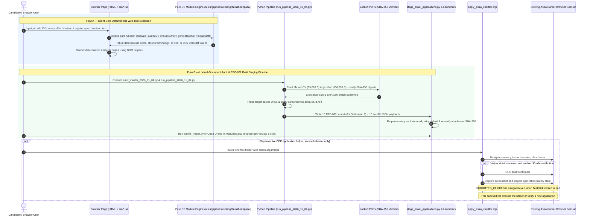

# Architecture — `radar-loker`

## Overview

`radar-loker` is a dual-surface repository combining:

1. **Zero-Dependency Static 7-in-1 Career & Engineering Web Suite** (`index.html`, `eksperimen.html`, `sidang.html`, `gaji.html`, `roast-cv.html`, `datasheet.html`, `pasal.html` + ES modules in `src/`): Pure client-side, deterministic heuristic analyzers, salary calculators, thesis defense simulators, embedded C driver generators, and Indonesian labor-law (`UU 13/2003` vs `UU 6/2023` / `PP 35/2021`) word-diff explainers. No backend server, bundler, or third-party runtime dependencies are required.
2. **Job Application Audit, Draft Staging & CDP Application Helpers** (`audit_master_2026_11_04.py`, `run_pipeline_2026_11_04.py`, `scripts/build_data.py`, `execution-pack-2026-11-04/*`): Python/Node/PowerShell automation that enforces SHA-256 & byte-length locks on official application documents (Master ATS CV, Diploma/Ijazah, Academic Transcript), contains code to query recruitment endpoints (`careerservice.astra.co.id`), stages RFC-822 `.eml` drafts (`X-Unsent: 1`) + autofill JSON payloads without unsolicited live email sends, and compiled the historical 2026-11-04 audit ledger (`audit-2026-11-04.json`, `dashboard-2026-11-04.html`).

---

## System Context & Data Flow (`graph TD`)

```mermaid
graph TD
  subgraph WebSuite["1. Static 7-in-1 Web Suite (Browser ES Modules)"]
    NAV["src/nav.js (Shared Suite Navigation)"]
    P1["index.html + src/app.js (01 Detektor Loker UI)"]
    R1["src/rules.js (14 Fraud/Labor Rules + Salary/Age Parser)"]
    P2["eksperimen.html (02 30-Day AI Job Funnel)"]
    P3["sidang.html + src/sidang.js (03 Thesis Defense Simulator + Web Speech)"]
    P4["gaji.html + src/gaji.js (04 Salary vs UMK 16 Cities Calculator)"]
    P5["roast-cv.html + src/roast.js (05 HRD/ATS CV Auditor & XYZ Rewriter)"]
    P6["datasheet.html + src/datasheet.js (06 Register Map -> STM32/ESP32 C Driver)"]
    P7["pasal.html + src/pasal.js (07 LCS Word Diff & PKWT Clause Explainer)"]
    STYLE["style.css (OKLCH Light/Dark Design Tokens)"]
  end

  subgraph StaticData["2. Published Aggregate JSON & CLI Scanners"]
    CSV_IN["Crosscheck CSV (Local Raw Tracker)"]
    BUILD_PY["scripts/build_data.py (Privacy-Preserving Aggregator)"]
    EKSP_JSON["data/eksperimen.json (Anonymized Funnel/Portal/Role Counts)"]
    LOG_JSON["data/log.json (Daily Experiment Notes)"]
    SCAN_CLI["scripts/scan.mjs (Batch .txt Job Ad Red-Flag Scanner)"]
  end

  subgraph ExecPipeline["3. Evidence-First Audit & Staging Pipeline (2026-11-04)"]
    LOCKED_DOCS["Locked PDFs (Master CV ATS + Ijazah + Transkrip)"]
    AUDIT_PY["audit_master_2026_11_04.py (174-Entry Master Ledger & HTML Builder)"]
    PIPE_PY["run_pipeline_2026_11_04.py (SHA-256 Verifier + HTTP Probe + .eml Generator)"]
    RANK_PY["execution-pack-2026-11-04/rank_astra_vacancies.py (Non-Sales Elektro Filter)"]
    STAGE_PY["execution-pack-2026-11-04/stage_email_applications.py (RFC-822 Inspector & Manifest)"]
    ASTRA_MJS["apply_astra_shortlist.mjs / apply_astra_13651.mjs (CDP Browser Helpers, Live Actions)"]
    ASTRA_REMOTE["Astra Career Browser Session / Application History"]
    AUTO_HELP["autofill_helper.py & Open-Drafts-In-MailClient.ps1 (1-Click Draft Launchers)"]
    ARTIFACTS["execution-pack-2026-11-04/eml/*.eml + payloads/*.json + audit-2026-11-04.json"]
  end

  NAV --> P1
  NAV --> P2
  NAV --> P3
  NAV --> P4
  NAV --> P5
  NAV --> P6
  NAV --> P7
  P1 --> R1
  SCAN_CLI --> R1
  CSV_IN --> BUILD_PY --> EKSP_JSON
  EKSP_JSON --> P2
  LOG_JSON --> P2
  STYLE --> WebSuite

  LOCKED_DOCS --> AUDIT_PY
  LOCKED_DOCS --> PIPE_PY
  AUDIT_PY --> ARTIFACTS
  PIPE_PY --> ARTIFACTS
  RANK_PY --> ARTIFACTS
  ARTIFACTS --> STAGE_PY
  STAGE_PY --> AUTO_HELP
  RANK_PY --> ASTRA_MJS
  ASTRA_MJS -->|"May click Lamar and final Konfirmasi"| ASTRA_REMOTE
```



---

## Execution & Pipeline Sequence (`sequenceDiagram`)



---

## Module Breakdown

| Path | Layer | Responsibility | Key Exports / Entry Points |
| :--- | :--- | :--- | :--- |
| `src/nav.js` | Web UI | Unified navigation bar across all 7 tools with active `aria-current="page"` state. | `TOOLS`, `mountNav(activeId)` |
| `src/rules.js` | Web Engine | Indonesian job-ad red-flag detector: 14 regex rule groups, negation/company-covered context window, Rupiah salary parser, narrow age-limit detector, and weighted risk scorer (`0–100`). | `RULES`, `MIN_WAGE_FLOOR`, `normalize()`, `extractSalary()`, `analyze()` |
| `src/app.js` | Web UI (`index.html`) | DOM controller for `Detektor Loker`, binding `#form`, preset sample ads (`scam`, `subtle`, `ok`), URL `?q=` hydration, and clipboard share URL builder. | Module side-effect controller |
| `src/gaji.js` | Web Engine (`gaji.html`) | Fresh-graduate salary benchmark engine comparing gross offers against 2025/2026 UMK across 16 industrial cities, 5 role multipliers, ~4% BPJS net THP, kos/makan/transport living costs, and HR negotiation scripts. | `CITIES`, `ROLES`, `evaluateOffer()` |
| `src/roast.js` | Web Engine (`roast-cv.html`) | Deterministic CV auditor scoring metrics, action verbs, passive phrases, cliches, and PII leaks (`NIK`, marital/religion metadata, UMP salary expectations) with 3 personas (`jaksel`, `pabrik`, `ats`) and XYZ bullet rewrites. | `auditCV(raw, persona)` |
| `src/sidang.js` | Web Engine (`sidang.html`) | Thesis defense simulator detecting unquantified adjectives, missing sample sizes, missing baselines, and failure modes; generates 5 examiner questions (`bambang`, `ratna`, `hendra`) and scores spoken/written answers. | `EXAMINERS`, `PRESET_THESES`, `generateQuestions()`, `scoreAnswer()` |
| `src/datasheet.js` | Web Engine (`datasheet.html`) | Parses compact register-map specs (`INA219`, `MPU6050`, `BMP280`, or custom) into portable C11 `.h` headers, `.c` STM32 HAL / ESP-IDF I2C drivers, and self-contained mock-bus unit tests (`test_<dev>.c`). | `SENSOR_PRESETS`, `parseSpecText()`, `specToText()`, `generateDriver()` |
| `src/pasal.js` | Web Engine (`pasal.html`) | Deterministic case-insensitive LCS word diff (`diffWords`) + legal impact translator (`IMPACT_RULES`) for PKWT duration, compensation (`PP 35/2021`), overtime removal, diploma retention, resign penalties, and outsourcing clauses. | `PASAL_PRESETS`, `diffWords()`, `explainDiff()` |
| `scripts/scan.mjs` | Node CLI | Batch CLI scanner reading a directory of `.txt` job postings through `analyze()` and printing console frequency tables or `--json`. | CLI (`node scripts/scan.mjs <dir> [--json]`) |
| `scripts/build_data.py` | Python Data ETL | Privacy-preserving aggregator converting raw application CSV logs into `data/eksperimen.json` (deduplicated counts by funnel stage, anonymized corporate portals, and role families). | `portal_label()`, `stage_of()`, `role_family()`, `main()` |
| `audit_master_2026_11_04.py` | Python Audit | Consolidates 174 tracked job applications across historical batches, verifies locked PDF hashes (and blocks deprecated `SKL`), and generates `audit-2026-11-04.json`, Markdown report, and interactive `dashboard-2026-11-04.html`. | `verify_documents()`, `generate_markdown_report()`, `generate_dashboard_html()`, `main()` |
| `run_pipeline_2026_11_04.py` | Python Staging | Verifies locked PDFs, queries Astra Career live API, probes 10 target URLs, builds & roundtrip-verifies 10 RFC-822 `.eml` drafts + JSON autofill payloads, and updates audit artifacts. | `verify_locked_documents()`, `generate_eml_package()`, `generate_portal_payload()`, `main()` |
| `execution-pack-2026-11-04/*` | Draft and Live-Action Helpers | Shortlist ranker, email manifest verifier and draft launchers. `apply_astra_shortlist.mjs:125` additionally automates an authenticated portal session, including a possible final Konfirmasi click at line 166. Its returned status at line 178 does not establish successful submission. | CLI / helper scripts, some with external side effects |

---

## State Management

1. **Stateless Functional Core (`src/*.js`)**: Every analyzer (`analyze`, `evaluateOffer`, `auditCV`, `generateQuestions`, `scoreAnswer`, `parseSpecText`, `generateDriver`, `diffWords`, `explainDiff`) is a pure synchronous function taking plain strings/objects and returning fresh value objects. Global regexes inside `RULES` reset `p.lastIndex = 0` prior to scanning (`src/rules.js:283`).
2. **Ephemeral Browser UI State**:
   - `index.html` (`src/app.js`) optionally serializes the current job-ad text into the `?q=` query parameter (capped at `< 1800` chars) via `history.replaceState` for stateless link sharing.
   - `sidang.html` holds active question set (`current`) and per-question scores (`scores`) in module-scoped variables during the page session, driving Web Speech API (`window.speechSynthesis`) utterances on demand.
   - `eksperimen.html` hydrates read-only JSON snapshots (`data/eksperimen.json` and `data/log.json`) at load time and computes current experiment day in local calendar time (`localDate`).
3. **Immutable File-Hash State in Execution Pipeline**:
   - Source application PDFs are hash-locked. Generated audit and staging artifacts are mutable outputs and may be overwritten by the pipeline. PDF locks use `MASTER_CV_EXPECTED_SHA256` (`c0a566b3...`) and `IJAZAH_EXPECTED_SHA256` (`65093593...`).
   - Draft-generation routines stage `.eml` files with `X-Unsent: 1` and compose URLs. This scope does not cover every automation script. `apply_astra_shortlist.mjs` can click the final Konfirmasi button and then inspect account history. The review did not run it. The helper returns `SUBMITTED_CLICKED` even if no final button was clicked, so that label and a screenshot alone are not a confirmed submission receipt.

---

## Running & Verifying Tests Locally

Execute both the Node.js ES module test runner and the Python `pytest` suite from the repository root (`C:\Users\ardhy\.gemini\antigravity\scratch\radar-loker`):

```powershell
Set-Location 'C:\Users\ardhy\.gemini\antigravity\scratch\radar-loker'

# 1. Run all JavaScript ES module unit & integration tests (Node >= 20 built-in test runner)
npm test
# Equivalent direct command:
node --test "tests/*.test.mjs"

# 2. Run all Python pipeline, data ETL, and RFC-822 staging verification tests
C:\Python314\python.exe -m pytest -v
```

## Source crosscheck, 2026-11-08

The two surfaces have different side effects: browser analyzers are local deterministic functions, while audit/staging scripts may contact remote recruitment services, overwrite generated artifacts, open portals/mail clients or use the clipboard. The separate shortlist CDP helper can also submit a portal application through a final Konfirmasi click, and must not be described as staging-only. Local verification must import bounded pure helpers and stub transports. Historical counts and document byte sizes in the sequence describe that snapshot, not a new submission or live vacancy check. Stored legal/wage heuristics are unverified source content, not current legal or financial guidance.
